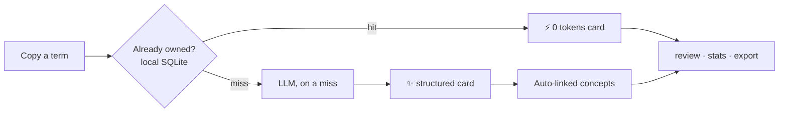
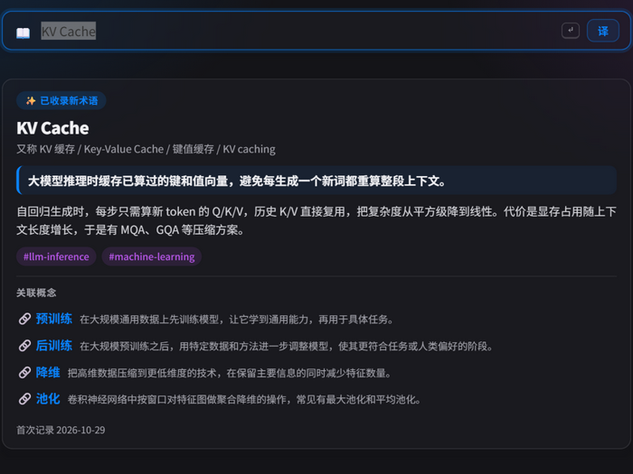

<div align="center">

# gloss

**Learn a term once, own it forever.**

English | [简体中文](README.zh-CN.md)

> A vocabulary notebook with an LLM for a heart · local-first · works with any OpenAI-compatible API

[](https://github.com/zhengqiuyang/gloss/actions/workflows/ci.yml)
[](LICENSE)

[](https://github.com/zhengqiuyang/gloss/stargazers)
[](https://github.com/zhengqiuyang/gloss/commits)

**Install** — one command, no API key needed:

```bash
uv tool install "gloss-cli[app] @ git+https://github.com/zhengqiuyang/gloss"
```

[How it works](#how-it-works) · [Quickstart](#quickstart) · [Zero typing](#zero-typing) · [Platform support](#platform-support) · [Roadmap](#roadmap) · [Privacy](#privacy)

</div>

## You pay for the same word three times

It's 11 PM. You're deep in a paper on retrieval-augmented generation.

Third paragraph. An acronym blocks the way: **HNSW**.

You know the drill. New tab. Search. Two blog posts, skimmed. Layered graphs,
greedy descent — trading a little accuracy for a hundredfold speed. Got it.
Back to the paper.

Ten minutes later:

**HNSW.**

Again.

You stare at it for three seconds. *Wait… what did I look up about it?*

So you go search again.

That's not a memory problem — it's a tool-shape problem. Search engines and
chat windows are built for one question at a time: you ask, they answer, and
the relationship ends. Ask about HNSW three times, pay three times, and the
answer evaporates three times — they don't remember HNSW, let alone QUIC from
last week or "vector database" from the week before. Those three terms are
relatives, but nothing ever put them on the same page.

Old-school study tools solved the keeping part long ago: the vocabulary
notebook. Look up, write down, glance at it next time — look, record, review,
a complete loop. It has one fatal flaw: it has never heard of HNSW, QUIC, or
MCP. Words missing from its dictionary get silence — and those are exactly
the words that block today's reading.

**gloss gives the vocabulary notebook an LLM for a heart.** Copy a term, tap
a key, and a card appears: a one-line definition, a few sentences of plain
explanation, related concepts. It lives on your own machine — and you will
never look this word up again.

Daily use is a light habit: hit an unfamiliar term, copy, ⌘G (Mac) or
Ctrl+G (Windows), the card floats up, click a related concept to take it
with you, Esc back to reading. `gloss review` flips your week's margin notes
back in front of you — "what was it I looked up?" is now its job, not yours.
`gloss stats` keeps a rough estimate of the tokens you didn't spend
(estimated as what a fresh lookup would have cost). `gloss export` writes the
whole notebook out as Obsidian wikilinks — the data is yours, and always was.

Three months from now, `gloss related RAG` shows you a graph: not a knowledge
map someone else drew, but one your own reading grew. No term you've ever
looked up should live out its days inside a chat window.

## Why "gloss"?

A *gloss* is the note a medieval scribe wrote in the margin of a manuscript
to explain a difficult word — the word is Greek in origin, *glōssa*, "tongue,
language". When a strange Latin word appeared, the scribe wrote a
plain-language note beside it; as the notes piled up, someone collected them
into a book — which is where *glossary* comes from.

gloss does the same thing, and it deliberately keeps three virtues of the
margin note: **it never interrupts** — copy, glance, back to reading;
**it stays beside the original** — it remembers where you met the term (the
source and the context), not just a bare definition; **it endures** — written
on your own machine, every note kept.

It writes the margin notes for you, and keeps every one of them.

<a id="how-it-works"></a>
## How "once" becomes "forever"

1. **Lookup is caching** — every term is checked against local SQLite first;
   the LLM is called only on a miss. Repeats are answered from your own disk:
   no tokens, no wait on a model, and they work offline. (Refresh, or delete
   and re-ingest, calls the model again — on purpose.)
2. **Cards, not chat bubbles** — aliases, a one-line definition, a short
   explanation, domain tags, where you met it: stored structured, searchable.
3. **Concepts link to concepts** — when a new card mentions a term you already
   own, they're linked automatically; unknown names are parked and back-filled
   into a two-way link when you gloss them later.



<p align="center">
  
</p>

Every lookup tells you whether it was a `⚡ 0 tokens` cache hit (the card was
answered locally) or a fresh `✨ card` — and `gloss stats` keeps a running
estimate of what a cache-less setup would have spent.

<a id="quickstart"></a>
## 30 seconds (no API key needed)

> [!TIP]
> `gloss demo` imports 9 interlinked sample cards and every feature works
> offline. Install, the demo, and browsing what you already own never need
> a key — only *generating new cards* does (configure any OpenAI-compatible
> service below, also 30 seconds).

```bash
uv tool install "gloss-cli[app] @ git+https://github.com/zhengqiuyang/gloss"
gloss demo            # 9 interlinked sample cards, every feature works offline
gloss ls              # what the library looks like
gloss related RAG     # how concepts connect
gloss search 向量      # full-text search
gloss review          # last 7 days
```

## Configure (30 seconds, any OpenAI-compatible API)

On macOS, the first interactive `gloss app` launch without an API key offers
terminal setup before starting the background app. Enter the service URL,
model and hidden API key; switching to your browser is safe. Cancel without
saving, or skip for the offline demo. To configure again:

```bash
gloss setup
```

Setup makes no model request. Existing keys, hidden launches, login startup
and non-interactive invocations bypass the prompt. Individual settings are
also available below, but a key passed as an argument enters shell history:

```bash
gloss config set llm.api_key sk-...
gloss config set llm.base_url https://api.deepseek.com/v1   # DeepSeek, for example
gloss config set llm.model deepseek-chat
```

DeepSeek, GLM, Ollama (local and free)… anything with an OpenAI-compatible API, two lines to
switch. Or skip the terminal: the popup's **⚙ settings panel** (from
`gloss serve` / `gloss app`) edits the same values and has a connection test
(it makes one tiny real call to the model). Other options (explanation
language, detail length, vision model, hotkey, query-on-pop vs
confirm-with-Enter) — see `gloss config show`. Config lives in
`~/.gloss/config.toml`; the library is `gloss.db` next to it.
While Mac settings are open, switching apps keeps the panel visible and
reopening preserves unsaved fields. Closing settings restores lookup-mode
auto-hide. The explicit Reload menu action resets the page. Clipboard text
exactly matching a configured API key is excluded from prefill and automatic
lookup; this is not a general secret detector.

<a id="zero-typing"></a>
## Zero typing: copy, then one key

Day-to-day usage isn't typing commands — it's **copy → one action → back to
reading**:

| Platform | Daily shape |
|---|---|
| macOS | `gloss app` lives in the menu bar (background by default — closing the terminal is fine); **⌘G** pops the floating card (`⌘⇧⌃4` screenshots get parsed too); `gp` for one-key capture; `gloss paste --notify` for notification mode |
| Windows | `gloss hotkey` lives in the tray; **Ctrl+G** pops a frameless card (`Win+Shift+S` screenshots likewise) |
| Everywhere | `echo "a passage" \| gloss` digests it into a snippet card; `gloss tr` translates the clipboard; `gloss serve` is a local web popup + HTTP API; `gloss export` writes Obsidian wikilinks / JSON backups |

By default, popping the card auto-queries whatever is in the clipboard — an
uncached term (or screenshot) is sent to the model provider you configured.
Prefer a beat of confirmation? `gloss config set app.auto_lookup false` (or
the ⚙ panel) switches to prefill-then-Enter, text and screenshots alike.
New installs default to **⌘G on macOS** and **Ctrl+G on Windows**.
Windows registers Ctrl+G directly; it does not first try Win+G.
Explicit custom shortcuts use `gloss config set app.hotkey <combo>`.

Hotkey, Raycast, Shortcuts and AutoHotkey recipes live in
[extras/README.md](extras/README.md).

<a id="keep-it-running"></a>
## Keep it running (macOS)

`gloss app` detaches by default — start it, close the terminal, keep
glossing. There is only ever one instance.

| Command | What it does |
|---|---|
| `gloss app` | background + floating card; the terminal can close |
| `gloss app --hidden` | background, no popup on start |
| `gloss app --foreground` | foreground, logs in the terminal (debugging) |
| `gloss app --startup` | login autostart (user-level LaunchAgent, hidden) + ensures it runs |
| `gloss app --no-startup` | cancel autostart — library and config untouched |
| `gloss app --status` / `--stop` | diagnostics / stop the background instance |
| `gloss setup` | configure the service in the terminal with hidden key input |

Quitting from the menu bar is a full quit: nothing relaunches it behind your
back — with autostart on, gloss comes back at your next login. Hotkey and
model changes need an app restart to take effect.

<a id="platform-support"></a>
## Platform support

| Layer | Where it runs |
|---|---|
| Core CLI — lookup, glossary, edit/rm, translate, review, stats, export, `gloss serve`, `gloss demo` | **Cross-platform** (any Python 3.9+; runtime deps only click/rich/openai) |
| `gloss paste` (clipboard capture: text + screenshots) | **macOS & Windows**; Linux needs adapters (see `src/gloss/clipboard.py`) |
| `gloss hotkey` (global-hotkey popup + tray) | **Windows only** — frameless WebView2 card; the macOS counterpart is `gloss app` |
| `gloss app` (menu bar + ⌘G popup, background/autostart) | **macOS only** — pyobjc, Carbon hotkey |

<a id="roadmap"></a>
## Roadmap

- [x] Zero-typing capture: `gloss paste` + global hotkeys (⌘G on macOS, Ctrl+G on Windows)
- [x] Local web popup + HTTP API (`gloss serve` — the base for every future surface)
- [x] Menu-bar app (macOS) / tray frameless card (Windows)
- [ ] Semantic search with local embeddings
- [ ] Spaced-repetition review (`gloss quiz`)
- [ ] MCP server so editors/agents can query your glossary
- [ ] WeChat/Telegram bot (built on `gloss serve`'s API)
- [ ] Multi-machine sync

<a id="privacy"></a>
## Privacy

> [!IMPORTANT]
> Your glossary is a local SQLite file. Only what you deliberately submit
> goes to the LLM provider you configured: the term you look up, your
> existing term list (used for linking), any context/source note attached,
> pasted text you digest, screenshots you parse, and text you translate.
> No telemetry, nothing else leaves your machine.

## Contributing

PRs welcome — see [CONTRIBUTING.md](CONTRIBUTING.md). Development is a
standard hatchling project: `uv venv && uv pip install -e ".[dev]"`, then
`pytest`.

## License

[MIT](LICENSE)
