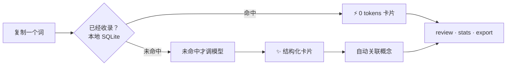
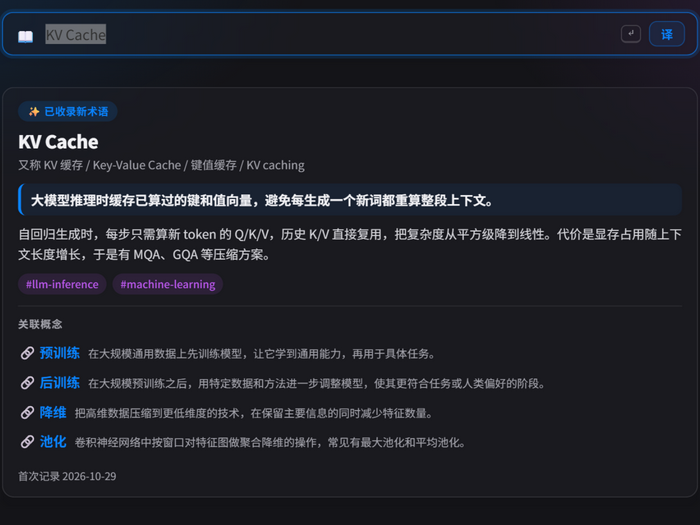

<div align="center">

# gloss

**查一次，永久拥有。**

[English](README.md) | 简体中文

> 给生词本换上一颗大模型的心脏 · 本地优先 · 任意 OpenAI 兼容服务

[](https://github.com/zhengqiuyang/gloss/actions/workflows/ci.yml)
[](LICENSE)

[](https://github.com/zhengqiuyang/gloss/stargazers)
[](https://github.com/zhengqiuyang/gloss/commits)

**安装** — 一条命令，无需 API key：

```bash
uv tool install "gloss-cli[app] @ git+https://github.com/zhengqiuyang/gloss"
```

[工作原理](#how-it-works) · [快速上手](#quickstart) · [零打字](#zero-typing) · [平台支持](#platform-support) · [Roadmap](#roadmap) · [隐私](#privacy)

</div>

## 同一个词，你付了三次钱

晚上十一点。你在读一篇讲检索增强的文档。

第三段，一个缩写挡住了去路：**HNSW**。

熟悉的流程。新标签页，搜索，两篇博客，略读。分层图、贪心查找——拿一点准确率
换百倍速度。懂了。切回文档，继续读。

十分钟后：

**HNSW。**

又来了。

你盯着它看了三秒。*刚才……我查过什么来着？*

于是，你又搜了一遍。

这不是记性的问题，是工具形状的问题。搜索引擎和聊天窗口都是为"一次一问"设计的：
你问，它答，缘分就尽了。问三次 HNSW，付三次钱，答案蒸发三次——它们不记得你问过
HNSW，更不记得你上周问过 QUIC、上上周问过向量数据库。这三个词本是亲戚，但你从来
没有机会把它们放在同一页纸上。

而所有老式学习工具里，其实早有人解决了"留住"：生词本。查过一次，抄下来，下次
遇见翻一眼——查、记、温，一个完整的闭环。只是它有个致命缺陷：它不认识 HNSW、
QUIC、MCP。词典里没有的词，它只会沉默——而恰恰是这些词，才是今天的阅读里
真正拦路的。

**gloss 给生词本换上大模型的心脏。** 复制一个词，敲一下，一张中文卡片立在那里：
一句话定义、几句人话解释、相关概念。它存在你自己的电脑里——这个词，你只查这一次。

日常用它是一种很轻的习惯：读到生词，复制，⌘G（Mac）或 Ctrl+G（Windows），卡片
浮出来，顺手点走一个相关的概念，Esc 回去继续读。`gloss review` 每周把你这一周
的页边注翻回来——"刚才查了什么来着"，从此是它替你记着。`gloss stats` 里有一个
省 token 的粗略估算（按"如果每次都现查要花多少"计）。`gloss export` 随时把整本
词库导出成 Obsidian 双链——数据是你的，从来都是。

三个月后 `gloss related RAG` 会给你一张网：不是别人画给你看的知识图谱，
是你的阅读自己长出来的。你查过的每个词，都不该只活在一个聊天窗口里。

## 为什么叫 gloss

*gloss* 是中世纪手抄本页边上，抄写员为难词写的小注——词源是希腊语 *glōssa*
（舌头、语言）。读拉丁文遇到生词，就在页边用通俗的话注一条意思；注越积越多，
有人把它们汇集成册，glossary（术语表）便由此而来。

gloss 做的是同一件事，而且刻意保留了页边注的三个好品质：**随手**——不打断
阅读，复制一下就回到原文；**贴着原文**——它记得你在哪遇到的这个词（来源与
语境），而不是一条孤零零的解释；**留得下来**——写在你自己的电脑里，每一条
都在。

替你写页边注，并把每一条都留下来。

<a id="how-it-works"></a>
## 它怎么做到"查一次，永久拥有"

1. **查询即缓存** — 每个词先查本地 SQLite，未命中才调模型。重复查询直接读
   本地：0 token、不用等模型、可离线。（主动刷新、或删除后重收，会再调
   模型——那是你主动要求的。）
2. **卡片，而不是聊天气泡** — 别名、一句话定义、简短详情、领域标签、来源语境，
   结构化地存着，随时全文检索。
3. **概念连着概念** — 新卡片提到你已收录的词，自动建链；没收录的先挂起，
   将来 gloss 它时自动回填成双向链接。



<p align="center">
  
</p>

每次查询都会告诉你是 `⚡ 0 tokens` 的缓存命中（本地直接作答），还是 `✨ 已收录`
的新卡——`gloss stats` 里有一个"如果每次都现查会花多少"的累计估算。

<a id="quickstart"></a>
## 30 秒上手（不需要 API key）

> [!TIP]
> `gloss demo` 导入 9 张互相关联的示例卡，全部功能离线可用。安装、示例、
> 浏览已有卡片都不需要 key——只有*生成新卡片*才需要（下面「配置」一节，
> 同样 30 秒配好任意 OpenAI 兼容服务）。

```bash
uv tool install "gloss-cli[app] @ git+https://github.com/zhengqiuyang/gloss"
gloss demo            # 导入 9 张互相关联的示例卡，离线体验全部功能
gloss ls              # 这份词库长什么样
gloss related RAG     # 概念怎么连成网
gloss search 向量      # 全文搜索
gloss review          # 近 7 天复盘
```

## 配置（30 秒，任意 OpenAI 兼容服务）

```bash
gloss config set llm.api_key sk-...
gloss config set llm.base_url https://api.deepseek.com/v1   # DeepSeek 为例
gloss config set llm.model deepseek-chat
```

DeepSeek、GLM、Ollama（本地、免费）……只要是 OpenAI 兼容接口，改两行就能换。
不想敲终端：弹窗里的 **⚙ 设置面板**（`gloss serve` / `gloss app` 都有）改的是
同一份配置，还带连接测试（会真实调用一次模型，消耗极少量 token）。其他可调项
（解释语言、详情长度、视觉模型、热键、呼出即查 vs 回车确认）用 `gloss config show`
查看。配置在 `~/.gloss/config.toml`，词库是同目录的 `gloss.db`。

<a id="zero-typing"></a>
## 零打字：复制即收录

日常的最佳用法不是敲命令，是**复制 → 一个动作 → 继续阅读**：

| 平台 | 日常形态 |
|---|---|
| macOS | `gloss app` 菜单栏常驻（默认后台运行，终端可以关）；**⌘G** 呼出浮窗（`⌘⇧⌃4` 截图直接解析）；`gp` 一键收录；`gloss paste --notify` 通知模式 |
| Windows | `gloss hotkey` 托盘常驻，**Ctrl+G** 呼出无边框卡片（`Win+Shift+S` 截图同理） |
| 全平台 | `echo "一段话" \| gloss` 消化成摘要卡；`gloss tr` 翻译剪贴板；`gloss serve` 网页弹窗 + HTTP API；`gloss export` 导出 Obsidian 双链 / JSON 备份 |

默认呼出弹窗即自动查询剪贴板——未收录的词（或截图）会发给你配置的模型服务商。
想先过目再查？`gloss config set app.auto_lookup false`（或 ⚙ 面板里关掉「自动查询」），
改为预填后按回车确认，文字与截图都一样。新安装默认 **Mac ⌘G、Windows Ctrl+G**。
Windows 直接注册 Ctrl+G，不先尝试 Win+G。自定义组合可用 `gloss config set app.hotkey <组合>`。

热键、Raycast、快捷指令、AutoHotkey 等配方见 [extras/README.md](extras/README.md)。

<a id="keep-it-running"></a>
## 常驻（macOS）

`gloss app` 默认后台运行——启动后终端可以关，菜单栏照常工作。永远只有一个实例。

| 命令 | 行为 |
|---|---|
| `gloss app` | 后台驻留 + 弹出浮窗；终端可以关 |
| `gloss app --hidden` | 后台驻留，启动时不弹窗 |
| `gloss app --foreground` | 前台运行，日志直接打在终端（调试用） |
| `gloss app --startup` | 写入登录自启（用户级 LaunchAgent，隐藏启动）并确保在运行 |
| `gloss app --no-startup` | 取消登录自启——不动词库和配置 |
| `gloss app --status` / `--stop` | 查看运行状态 / 停止后台实例 |

菜单栏「退出 gloss」是完全退出：不会有东西在背后悄悄把它拉起来——开了自启也是
下次登录才再启动。热键和模型配置的改动需要重启 gloss app 才生效。

<a id="platform-support"></a>
## 平台支持

| 层 | 可运行范围 |
|---|---|
| 核心 CLI——查询/词库/edit/rm/翻译/review/stats/export/`gloss serve`/`gloss demo` | **全平台**（Python 3.9+，运行时依赖仅 click/rich/openai） |
| `gloss paste`（剪贴板捕获：文字 + 截图） | **macOS & Windows**；Linux 需适配层（见 `src/gloss/clipboard.py`） |
| `gloss hotkey`（全局热键弹窗 + 托盘） | **仅 Windows**——WebView2 无边框卡片；macOS 对应能力是 `gloss app` |
| `gloss app`（菜单栏 + ⌘G 浮窗，后台/自启） | **仅 macOS**——依赖 pyobjc、Carbon 热键 |

<a id="roadmap"></a>
## Roadmap

- [x] 零打字捕获：`gloss paste` + 全局热键（macOS ⌘G / Windows Ctrl+G）
- [x] 本地 Web 弹窗 + HTTP API（`gloss serve`，一切未来入口的底座）
- [x] 菜单栏应用（macOS）/ 托盘无边框卡片（Windows）
- [ ] 本地 embedding 语义搜索（按意思找卡片）
- [ ] 间隔复习（`gloss quiz`）
- [ ] MCP server，让编辑器/agent 查你的词库
- [ ] 微信/Telegram bot（基于 `gloss serve` 的 API）
- [ ] 多机词库同步

<a id="privacy"></a>
## 隐私

> [!IMPORTANT]
> 词库就是本地一个 SQLite 文件。只有你主动提交的内容会发给你配置的模型服务商：
> 查询的词、用于关联的已有词表、附加的语境/来源备注、粘贴消化的文本、要解析的
> 截图、要翻译的文本。没有遥测，没有其他外发。

## 参与

欢迎 PR，见 [CONTRIBUTING.md](CONTRIBUTING.md)。开发是标准 hatchling 项目：
`uv venv && uv pip install -e ".[dev]"`，然后 `pytest`。

## 许可

[MIT](LICENSE)
